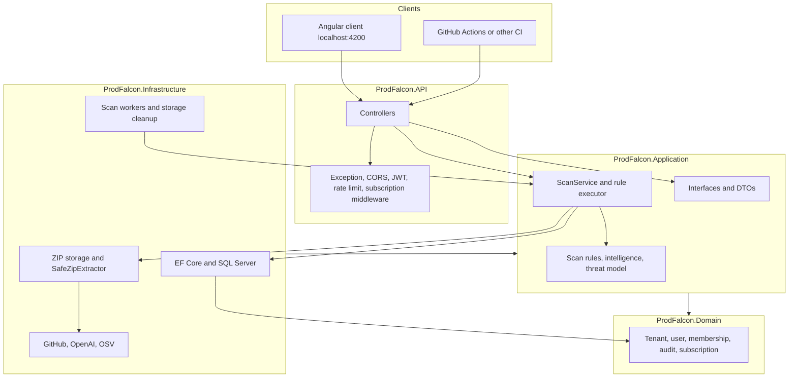
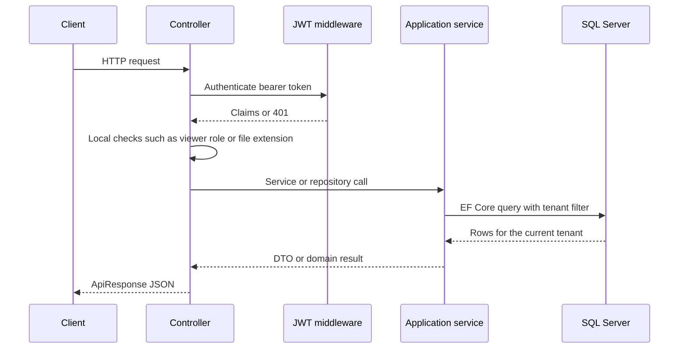
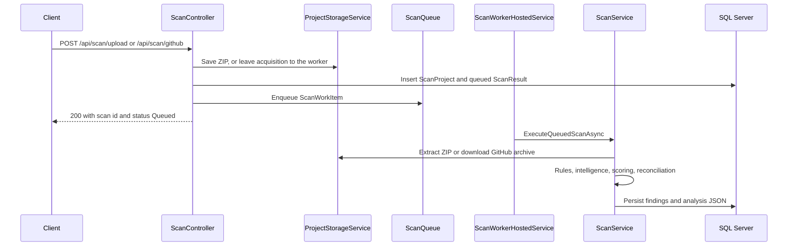

# ProdFalcon

ProdFalcon is an ASP.NET Core API that accepts a project archive or a GitHub repository, extracts the source under safety limits, and runs static analysis against that source. The result is a tenant-scoped scan: findings, scores, a project profile, an architecture graph, a threat model, and downloadable reports.

It exists so a developer or a small team can inspect an untrusted codebase without treating the upload as a trusted build. The scanners look for issues such as hardcoded secrets, SQL constructed by string concatenation, missing authorization attributes, permissive CORS, debug configuration, and known dependency vulnerabilities. They also record maintainability and reliability observations. A score is an indication of what those scanners detected. It is not a certificate that the project is secure.

The earlier README described a project and task-management product. That description does not match the source. There are no task, notification, or team-productivity modules. Projects in this API are uploaded or cloned codebases that have been scanned.

## Who it is for

- Developers who want a repeatable security and quality pass over a .NET or mixed-language repository.
- Teams that need tenant isolation between organizations sharing one API.
- Reviewers who want an HTTP API, persisted findings, and a written record of how the system is put together.

An Angular client is expected at `http://localhost:4200` or `https://localhost:4200`. That client is not part of this repository.

## Highlights

These behaviors are implemented in the current source.

- ZIP upload at `POST /api/scan/upload`, limited to `.zip` files and a configured maximum size (100 MB by default).
- GitHub acquisition at `POST /api/scan/github` for public repositories, with an optional token for private repositories. Downloads are restricted to GitHub hosts and follow a small number of redirects only when the next host is allowed.
- Bounded extraction through `SafeZipExtractor`: entry count, uncompressed size, compression ratio, and path checks that reject rooted paths and `..` segments.
- Background scanning. Two hosted workers read an in-memory queue, with a configurable timeout (10 minutes by default).
- Static rules for secrets, SQL concatenation, authentication and authorization attributes, HTTP usage, CORS wildcards, debug and Swagger configuration, logging, and a broader static-analysis pass.
- Dependency lookups against the OSV API (`https://api.osv.dev/`), capped by `Scanning:MaxDependencyQueries`.
- Project intelligence, an architecture graph, and a threat model stored as JSON on the scan and exposed by dedicated endpoints.
- Finding history, filters, pagination, status changes, and comparison between two scans.
- JSON, CSV, and PDF report downloads.
- JWT authentication, organization tenants, member invites, and a super-admin tenant list.
- Optional OpenAI suggestions. When `OpenAI:ApiKey` is empty, the API returns heuristic text derived from stored findings.
- A GitHub Actions workflow template (`prodfalcon.yml`) and a CI upload endpoint that evaluates a repository policy. Automatic pull requests are not implemented and return HTTP 501.

Stripe checkout and webhooks are stubs. They do not create a Stripe session or verify a Stripe signature. Monthly scan quotas are stored and displayed. The upload and GitHub endpoints do not enforce those quotas.

## Technology stack

Projects target `net8.0`. The solution file is `ProdFalcon.slnx`, which the .NET 9 SDK and later can open. This documentation was checked with the .NET SDK `10.0.402` on the authoring machine. A .NET 8 targeting pack is still required because the projects target `net8.0`.

| Technology | Version in project files | Role |
| --- | --- | --- |
| C# / .NET | `net8.0` | Language and runtime |
| ASP.NET Core | Web SDK, `net8.0` | HTTP API, authentication middleware, rate limiting, health endpoint |
| Entity Framework Core | 8.0.26 | SQL Server access, migrations, global query filters |
| SQL Server | Provider `Microsoft.EntityFrameworkCore.SqlServer` 8.0.26 | System of record for users, tenants, scans, and findings |
| SQLite | `Microsoft.EntityFrameworkCore.Sqlite` 8.0.26, test project only | In-memory database for API tests |
| JWT bearer | `Microsoft.AspNetCore.Authentication.JwtBearer` 8.0.26, `System.IdentityModel.Tokens.Jwt` 8.18.0 | Access tokens, HMAC-SHA256, one-day lifetime |
| BCrypt | `BCrypt.Net-Next` 4.2.0 | Password hashing |
| Swashbuckle | `Swashbuckle.AspNetCore` 10.1.7 | OpenAPI and Swagger UI in Development |
| Serilog | `Serilog.AspNetCore` 8.0.3, console sink 6.0.0 | Configuration-driven logging and request logging |
| xUnit | 2.5.3, with `Microsoft.NET.Test.Sdk` 17.8.0 and `Microsoft.AspNetCore.Mvc.Testing` 8.0.26 | Automated tests |
| Coverlet collector | 6.0.0 | Coverage collection when tests are run with `--collect:"XPlat Code Coverage"` |

`FluentValidation` 12.1.1 and `AutoMapper` 16.1.1 are package references on the Application project. No validators or mapping profiles are registered. `Scalar.AspNetCore` 2.14.14 is referenced by the API project and is not registered in `Program.cs`. `Microsoft.AspNetCore.Identity` is referenced by Infrastructure. Accounts are a custom `AppUser` table, not ASP.NET Core Identity.

EF Core is used because scan, tenant, and user data are relational and the tenant boundary is expressed as a global query filter. SQL Server is the configured production provider. Windows integrated security is the development default, so the local connection string does not contain a password. JWT is used because the API is stateless apart from the database and the in-memory scan queue. The trade-offs are recorded in [docs/ENGINEERING_DECISIONS.md](docs/ENGINEERING_DECISIONS.md).

## Architecture

The solution is a layered monolith. The API project references Application, Infrastructure, and Shared. Infrastructure references Application. Application references Domain and Shared. Domain references Shared because `SubscriptionTier` lives in Shared. That last reference, and the fact that scan persistence models live in Application rather than Domain, means this is not strict Clean Architecture. It is a pragmatic layering that still keeps EF Core and HTTP clients out of the domain types that do exist.



| Project | Responsibility |
| --- | --- |
| `ProdFalcon.API` | HTTP surface, JWT bearer setup, Serilog, CORS, rate limiting, exception middleware, health endpoint |
| `ProdFalcon.Application` | Scan orchestration, rules, scoring, DTOs, persistence interfaces, ZIP safety checks |
| `ProdFalcon.Domain` | Tenant, user, membership, audit, and subscription types and enums |
| `ProdFalcon.Infrastructure` | EF Core, repositories, GitHub and OpenAI clients, background workers, report writer |
| `ProdFalcon.Shared` | `ApiResponse`, `ConflictException`, `SubscriptionTier` |
| `ProdFalcon.Tests` | xUnit tests for rules, ZIP safety, tenant isolation, and selected API calls |

Dependency injection is registered in `ApplicationServiceRegistration` and `InfrastructureServiceRegistration`. Scan rules are individual `IScanRule` registrations. The scan queue is a singleton. Workers create a scope per job and set the tenant before calling `ScanService`.

Details, trade-offs, and diagrams: [docs/ARCHITECTURE.md](docs/ARCHITECTURE.md).

## System workflow

Authenticated calls carry `Authorization: Bearer <token>`. The token contains the user id, tenant id, organization, role, plan, and a super-admin flag. EF Core query filters restrict tenant-owned rows to `CurrentTenantId`. A viewer is rejected by specific actions (upload, GitHub scan, finding updates, repository registration). There is no global role policy.



Archive analysis is asynchronous for the interactive upload and GitHub endpoints. The CI endpoint runs the scan in the request.



Pipeline, failure behavior, and scaling limits: [docs/SYSTEM_DESIGN.md](docs/SYSTEM_DESIGN.md).

## Repository structure

```text
ProdFalcon.slnx
ProdFalcon.API/
  Controllers/          HTTP endpoints
  Middleware/           Exception handling and AI subscription gate
  Program.cs            Host composition
  appsettings.json      Local defaults. Do not treat secrets here as production configuration.
ProdFalcon.Application/
  DTOs/                 Auth, tenant, and admin contracts
  Scanning/             Rules, models, queue, ZIP safety, intelligence
  DependencyInjection/
ProdFalcon.Domain/
  Entities/             User, tenant, membership, audit, subscription
  Enums/
ProdFalcon.Infrastructure/
  Data/                 ApplicationDbContext
  Migrations/           EF Core migrations
  Services/             Auth, JWT, storage, GitHub, OpenAI, Stripe stub, queries
  Background/           Scan workers and storage cleanup
  Reporting/            JSON, CSV, and PDF writers
ProdFalcon.Shared/
ProdFalcon.Tests/
scripts/                Local start and stop scripts for Windows
docs/                   Engineering documentation
docs/adr/               Architecture decision records
.github/                CI workflow and issue templates
```

`ProjectStorage/ExtractedProjects/` is committed scan output from earlier runs. It is not product source. Runtime storage for new scans defaults to `ProdFalcon_Storage/`, which is gitignored. See [Current limitations](#current-limitations).

## Getting started

### Prerequisites

- .NET SDK 9 or later, so `ProdFalcon.slnx` opens, plus the .NET 8 targeting pack used by the projects. The .NET 10 SDK satisfies both when the 8.0 targeting pack is installed.
- SQL Server or SQL Server Express for the API process. Tests do not need SQL Server. They use SQLite in memory.
- Git.
- A local editor. Visual Studio or VS Code both work. Nothing in the build requires a specific IDE.

### Clone and restore

```bash
git clone https://github.com/aliahsan9/ProdFalcon.git
cd ProdFalcon
dotnet restore ProdFalcon.slnx
```

### Configuration

Development uses Windows integrated security. `Properties/launchSettings.json` and `scripts/Run-ProdFalconApi.ps1` set:

```text
Server=.\SQLEXPRESS;Database=ProdFalconDb;Trusted_Connection=True;TrustServerCertificate=True
```

That string has no password. Change the server name if you are not using a local `SQLEXPRESS` instance. Do not commit a SQL password, a JWT signing key, an OpenAI key, a Stripe key, or a GitHub webhook secret.

`appsettings.json` currently contains a development JWT signing key. Replace it before any shared or deployed use, and prefer environment variables or user secrets:

```bash
dotnet user-secrets set "Jwt:Key" "<a-long-random-value>" --project ProdFalcon.API
```

`Jwt:Key` must be long enough for HMAC-SHA256. Token generation throws if the key is missing. Token validation in `Program.cs` currently substitutes an empty string when the key is missing, which will reject tokens rather than start with a safe failure. Set the key explicitly.

Optional settings:

| Key | Effect when empty or unset |
| --- | --- |
| `OpenAI:ApiKey` | Suggestion and ask endpoints use local heuristic text |
| `GitHub:WebhookSecret` | `POST /api/github/webhook` returns 503 |
| `Stripe:SecretKey` and `Stripe:WebhookSecret` | Checkout remains a stub URL. The webhook handler does not update subscriptions |
| `Storage:RootPath` | Archives are stored under `ProdFalcon_Storage` next to the solution |
| `SuperAdmin:Emails` | Matching addresses are marked super-admin at registration or login |

Registration does not prove that the caller owns the email address.

### Database

The API applies EF Core migrations on startup unless the environment is `Testing`:

```csharp
await app.Services.MigrateDatabaseAsync();
```

You can also apply them yourself from the Infrastructure project:

```bash
dotnet tool restore
dotnet ef database update --project ProdFalcon.Infrastructure --startup-project ProdFalcon.API
```

`dotnet-ef` is not listed in a local tool manifest in this repository. Install it once with `dotnet tool install --global dotnet-ef` if `dotnet tool restore` does not provide it. The design-time factory is `ApplicationDbContextFactory`.

Migrations in the repository:

- `20260908150026_InitialCreate`
- `20261107060335_SecurityPlatformExpansion`
- `20261107061339_TenantScopedRepositoryRegistration`

### Run the API

From the repository root:

```bash
dotnet run --project ProdFalcon.API --launch-profile http
```

On Windows, `scripts/Run-ProdFalconApi.ps1` stops a previous listener and starts the `http` profile. `scripts/Stop-ProdFalconApi.ps1` stops it.

The `http` profile listens on `http://localhost:5014` and opens Swagger. The `https` profile also binds `https://localhost:7036`. Startup logs the same Swagger URL.

### Run the tests

```bash
dotnet test ProdFalcon.Tests/ProdFalcon.Tests.csproj
```

Coverage collection:

```bash
dotnet test ProdFalcon.Tests/ProdFalcon.Tests.csproj --collect:"XPlat Code Coverage" --results-directory TestResults
```

The test host sets the environment to `Testing`, replaces SQL Server with SQLite, and removes hosted workers so they do not share the in-memory database. A measured coverage figure is in [docs/TESTING.md](docs/TESTING.md). Do not treat that figure as a quality gate until the CI artifact for the commit you are reading has been produced.

## API documentation

Swagger UI is enabled only when the host environment is Development:

```text
http://localhost:5014/swagger
```

`AddSwaggerGen` does not register a bearer security scheme, so the Swagger page does not offer an Authorize button. Call `POST /api/auth/register` or `POST /api/auth/login`, copy `token`, and send:

```text
Authorization: Bearer <token>
```

Protected controllers use `[Authorize]`. `POST /api/auth/register`, `POST /api/auth/login`, `POST /api/tenants/invites/accept`, `POST /api/github/webhook`, `POST /api/github/ci`, and `POST /api/stripe/webhook` are anonymous. The CI endpoint still requires its own bearer scan token.

The endpoint catalog, status codes, and examples are in [docs/API_DOCUMENTATION.md](docs/API_DOCUMENTATION.md).

`GET /health` is mapped twice in `Program.cs`: once with `MapHealthChecks` and once with a custom handler that checks `Database.CanConnectAsync()` and returns `{ "status": "Healthy" }` or HTTP 503. Confirm which response your host returns before relying on it.

## Security

Authentication is not the same as a secure deployment. The implementation includes:

- BCrypt password hashes.
- JWT validation of issuer, audience, lifetime, and signing key when `Jwt:Key` is configured.
- Tenant query filters and tests that user B cannot read user A's scan.
- ZIP path and decompression limits.
- A fixed-window rate limit named `scans` (10 permits per minute, no queue) on ZIP upload and GitHub scan submission.
- CORS limited to the local Angular origins.
- An exception middleware that returns a generic message for unexpected errors outside Development.

It also has gaps that are documented with severity and status in [docs/SECURITY.md](docs/SECURITY.md). The important ones are a committed development JWT key, no email verification before super-admin assignment, scan quotas that are not enforced, a stub Stripe webhook, an in-memory queue that drops work on restart, and committed extracted projects under `ProjectStorage/`.

Report vulnerabilities using [SECURITY.md](SECURITY.md).

## Testing

`ProdFalcon.Tests` contains three test classes:

- `SecurityEngineTests` covers GitHub URL parsing, secret redaction, SQL concatenation detection, ZIP path escape, scoring, and fingerprints.
- `IntelligenceAndQualityTests` covers project profiling, architecture edges, quality rules, finding reconciliation, webhook signatures, copilot limits, and one public Hello World archive.
- `TenantIsolationTests` uses `WebApplicationFactory` against SQLite and checks cross-tenant scan, dashboard, AI, upload path, super-admin, and anonymous access.

There is no separate test project for every controller. Billing, Stripe, admin plan changes, and the scan worker are not covered by the current tests. A local Release run on 2026-11-07 passed 30 tests and Coverlet reported 22.88% line coverage for that run, including generated migration source. The breakdown is in [docs/TESTING.md](docs/TESTING.md).

## Engineering decisions

The layering, the placement of scan models, EF Core, SQL Server, JWT, DTO separation, validation, exception handling, and file storage are written up as architectural rationale, not as a claim that alternatives were benchmarked. See [docs/ENGINEERING_DECISIONS.md](docs/ENGINEERING_DECISIONS.md) and the records under [docs/adr](docs/adr).

## Current limitations

- The scan queue is in process. A restart loses queued work. There is no distributed lock, so a second API instance would run a second pair of workers against the same database without coordinating claims.
- Upload size, entry count, and compression ratio are enforced. Antivirus scanning is not.
- Scores describe scanner output. `SecurityScoreMethodology.Summary` states that explicitly. Dashboard `DocumentationScore`, `TestCoverageScore`, and `BugRiskScore` are `-1`, meaning those figures are not calculated.
- `FluentValidation` is unused. Request checks are manual `if` statements and a few thrown exceptions.
- Subscription scan limits and the billing usage counter are not enforced. `scansUsed` is always `0`. AI subscription checks are skipped in Development and Testing.
- Stripe does not call Stripe.
- `POST /api/github/auto-fix/{scanResultId}` returns 501.
- Swagger has no security scheme. Scalar is unused.
- `Program.cs` maps `/health` twice.
- `ProjectStorage/` contains extracted third-party trees and is tracked by git. New runtime files go to `ProdFalcon_Storage/`, which is ignored, but the older tree is still in the repository.
- Password policy is not implemented. Registration accepts the password string it is given, including a weak one.
- Invite tokens are returned in the API response. No mail sender is registered.

## Roadmap

Completed, partial, and planned work is split in [docs/ROADMAP.md](docs/ROADMAP.md). The nearest engineering risks are secret handling, removal of committed scan output, durable scan queuing, and enforcing the quotas the billing API already describes.

## Contributing

Branch names, commits, pull requests, and the expectation that tests are run are described in [CONTRIBUTING.md](CONTRIBUTING.md).

Issues and pull requests should use the templates in `.github/`.

## License

MIT. See [LICENSE.txt](LICENSE.txt).

Copyright (c) 2026 Ali Ahsan.

## Author

Ali Ahsan

GitHub: [https://github.com/aliahsan9](https://github.com/aliahsan9)
