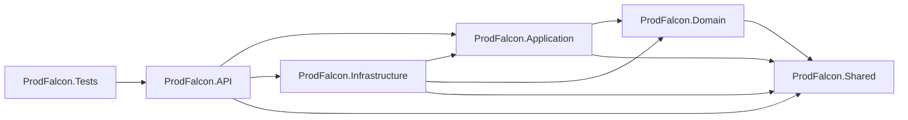
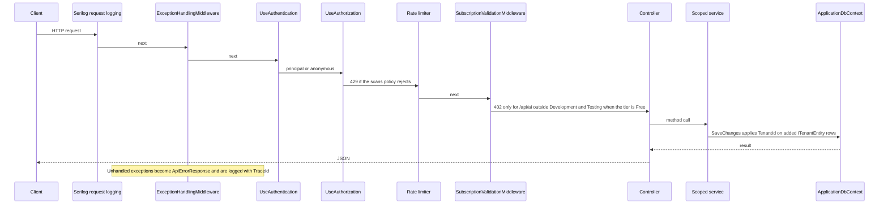

# Architecture

This document answers how the ProdFalcon backend is structured, which way dependencies point, and where that structure departs from a textbook Clean Architecture diagram.

The style is a layered monolith hosted as one ASP.NET Core process. One deployable API owns HTTP, scanning, persistence, and background work. That is a reasonable shape for the current product: a single team, one database, and a scan pipeline that must share tenant context with the request that queued it. Splitting scanners into separate services would add network and deployment cost before the queue is durable.

## Layer responsibilities

| Project | Owns | Does not own |
| --- | --- | --- |
| API | Routing, authentication middleware, CORS, rate limiting, Swagger in Development, exception translation, health mapping | Scan rules, SQL, ZIP extraction |
| Application | Use-case orchestration, `IScanRule` implementations, scoring, intelligence, threat model, DTOs, repository interfaces, `SafeZipExtractor` | EF Core, HTTP clients, the web host |
| Domain | `AppUser`, `Tenant`, `TenantMember`, `AuditLog`, `UserSubscription`, role and status enums, `ITenantEntity` | Scan findings, controllers, database configuration |
| Infrastructure | `ApplicationDbContext`, migrations, repositories, JWT issuance, BCrypt authentication, GitHub and OpenAI HTTP clients, OSV lookups, background workers, report files | HTTP route design |
| Shared | `ApiResponse<T>`, `ApiErrorResponse`, `ConflictException`, `SubscriptionTier` | Behavior |
| Tests | xUnit facts and one `WebApplicationFactory` | Production hosting |

`ProdFalcon.Tests` references only the API project. It reaches Application and Infrastructure types through that reference.

## Dependency direction

The intended flow is API to Application, and Infrastructure to Application, so that persistence implements interfaces declared beside the use cases. That part holds:

- `IScanService`, `IScanResultRepository`, `IAuthService`, `IProjectStorageService`, and the other application interfaces are implemented in Infrastructure or, for the scan rules, in Application itself.
- `ScanService` depends on those interfaces. It does not reference EF Core.

The boundaries are not strict.

- The API project references Infrastructure. Controllers use `ScanReportWriter`, and `Program.cs` calls `MigrateDatabaseAsync` and maps a health check that injects `ApplicationDbContext`. `StripeController` and `BillingController` depend on `IStripeSubscriptionService`, which is declared in the Infrastructure project rather than Application.
- Domain references Shared because `Tenant.Plan` and `UserSubscription.Tier` use `SubscriptionTier`. Domain is therefore not a dependency-free core.
- Scan persistence models (`ScanProject`, `ScanResult`, `ScanIssue`, `TrackedFinding`, `RepositoryRegistration`, `CopilotMessage`, `FindingStatusHistory`) live in `ProdFalcon.Application.Scanning.Models` and are mapped by EF Core. They are database entities sitting in the application layer. Domain does not contain the scanning model.
- `SafeZipExtractor` is application code with direct `System.IO.Compression` and filesystem calls. The storage service in Infrastructure calls it. The safety policy is testable without EF, which is why it sits beside the scanners, but it is not a pure function of domain state.

Calling the solution "Clean Architecture" without those exceptions would overstate the dependency rule. The practical benefit that does exist is that a scan rule can be unit tested without SQL Server, and the API project is not where SQL is written.

## Composition and dependency injection

`Program.cs` is the composition root.

1. Serilog reads the `Serilog` section.
2. `AddApplication()` registers `ScanRuleExecutor`, `RiskScoringService`, `ProjectScanner`, and one `IScanRule` per built-in rule.
3. `AddInfrastructure()` registers SQL Server, scan limits, named HTTP clients (`OpenAI`, `GitHub`, `OSV`), scoped services, the singleton `ScanQueue`, and two hosted services.
4. JWT bearer authentication is configured from `Jwt:Issuer`, `Jwt:Audience`, and `Jwt:Key`.
5. A fixed-window rate limiter named `scans` allows 10 permits per minute and queues nothing.
6. CORS policy `Frontend` allows `http://localhost:4200` and `https://localhost:4200` with credentials.
7. Outside the `Testing` environment, `MigrateDatabaseAsync` applies EF migrations.
8. Middleware order is Serilog request logging, `ExceptionHandlingMiddleware`, Swagger in Development, CORS, HTTPS redirection, authentication, authorization, rate limiting, `SubscriptionValidationMiddleware`, then controllers.

Scoped services follow the HTTP request. The scan worker cannot use the request scope, so it creates a new scope, calls `ITenantProvider.SetTenant`, and then resolves `IScanService`. Forgetting that step would make the global query filter see `Guid.Empty` and hide the job's rows. The worker sets the role to `TenantRole.Owner` for the duration of the job. That override is process-local. It is not a second authentication decision.

`BackgroundServiceExceptionBehavior.Ignore` is set so a fault in a hosted service does not stop the host. The worker also catches exceptions per job and logs them. A failed scan is marked `Failed` inside `ScanService` before the exception is rethrown.

## Application boundaries

There is one process boundary. External systems are reached by named `HttpClient` instances:

| Client | Base or hosts | Timeout | Notes |
| --- | --- | --- | --- |
| `GitHub` | `api.github.com`, `codeload.github.com`, `github.com`, `objects.githubusercontent.com` | 2 minutes | Auto-redirect is disabled. The client follows up to four redirects and rejects other hosts |
| `OpenAI` | `OpenAI:BaseUrl`, default `https://api.openai.com/v1/` | 60 seconds | Used only when an API key is configured |
| `OSV` | `https://api.osv.dev/` | 20 seconds | Dependency vulnerability queries, capped by configuration |

File storage is a directory on the API machine. It is not a separate service.

## Domain responsibilities

Domain types represent the organization boundary:

- A user has a name, a normalized email, a BCrypt password hash, and a super-admin flag.
- Registration creates a tenant, an owner membership, and a free subscription in one transaction.
- Membership roles are `Viewer`, `Developer`, `SecurityReviewer`, `Admin`, and `Owner`.
- Tenant status is `Active`, `Suspended`, or `Deleted`. Deleted tenants are excluded by a query filter on `IsDeleted`.
- Audit rows record an action name, a timestamp, and a metadata string.

The domain project does not enforce invariants in methods. Entities are property bags. Rules such as "viewers cannot upload" are implemented in controllers. Rules such as "a finding status must be one of a fixed set" are implemented in `ScanQueryService`. That is a consequence of putting behavior in services. It keeps entities easy to map and makes the rules harder to find.

## Infrastructure abstractions

Application code asks for interfaces:

- `IProjectStorageService` saves, validates, extracts, and deletes a project directory.
- `IRepositoryAcquisitionService` downloads a GitHub archive into that store.
- `IScanResultRepository` and `IScanProjectRepository` persist scan state.
- `IProjectWorkspaceStore` stores tracked findings, copilot messages, and repository registrations.
- `IJwtService` and `IAuthService` issue tokens and create accounts.
- `ITenantProvider` reads claims or an explicit override set by the worker, a webhook, or the CI endpoint.

EF Core configuration, including column lengths and indexes, is entirely in `ApplicationDbContext.OnModelCreating`. There are no `IEntityTypeConfiguration` classes.

## Request lifecycle

Controller actions that expect a body use the framework's JSON binder. They do not use FluentValidation. Invalid JSON becomes the framework's default validation problem response. Business failures are a mix of `ApiResponse<T>.Fail` returned directly and exceptions handled by middleware.

`ExceptionHandlingMiddleware` maps:

| Exception | Status | Body message |
| --- | --- | --- |
| `KeyNotFoundException` | 404 | Exception message |
| `ConflictException` | 409 | Exception message |
| `ArgumentException`, `InvalidOperationException` | 400 | Exception message |
| `UnauthorizedAccessException` | 401 | `Unauthorized.` The original message is not returned by the middleware |
| `NotImplementedException` | 501 | Exception message |
| Any other exception | 500 | `An unexpected error occurred.` In Development, `errors.detail` contains `exception.Message` |

Auth endpoints catch `ConflictException` and `UnauthorizedAccessException` themselves and return `{ success, message }`, so login can still say `Invalid credentials.` That path does not go through the middleware mapping above.

## Validation strategy

Validation is local and inconsistent across endpoints.

- Upload checks null, empty, max length, and a `.zip` extension, then `ValidateZipAsync`.
- GitHub URLs go through `GitHubUrlParser`. Branch names go through `IsValidBranch`.
- Finding status updates allow `Open`, `Detected`, `Acknowledged`, `InProgress`, `Resolved`, and `AcceptedRisk`. `Verified` is rejected because that state is written only when a later scan no longer reports a resolved finding.
- Register and login DTOs have no data annotations and no validator. The auth service trims and lowercases email and trims the display name. It does not check password length.
- Pagination clamps page size to 1–100 and page to at least 1.

The absence of a shared validator is a gap, not a hidden framework. Adding FluentValidation later would match the package that is already referenced and would give one place for password and DTO rules.

## Error-handling strategy

Expected failures inside a scan are persisted. `ScanService` sets the project and the scan to `Failed` or `Cancelled` and stores a trimmed error message. The worker logs the exception and continues with the next queue item. The interactive client learns the outcome by reading `GET /api/scan/{id}`, not from the original upload response. The upload response is returned as soon as the job is queued.

The CI endpoint is different. It calls `ExecuteQueuedScanAsync` on the request thread and returns 200 or 422 from the policy evaluation. A scanner exception on that path is an HTTP error.

Startup database migration failures are not caught in `Program.cs`. If SQL Server is down, the process fails before it listens.

## Trade-offs

Keeping scanners, EF Core, and the API in one solution makes a scan easy to trace and easy to test with `WebApplicationFactory`. It also means a long scan shares the process with HTTP traffic. The worker timeout and the two-consumer queue limit damage from a single archive, but they do not isolate a hostile archive from the API process. A crash in unmanaged code, disk exhaustion, or a poisoned singleton queue affects the whole host.

Putting scan entities in Application let the scanning feature grow without a parallel domain model. The cost is that persistence shape and use-case shape are the same types. Changing a column often means changing a type the scanners construct.

Referencing Infrastructure from the API made reports, migrations, and the Stripe stub faster to wire. The cost is that the API can bypass application services, and several controllers already do.

## Related documents

- [SYSTEM_DESIGN.md](SYSTEM_DESIGN.md) for the scan pipeline and failure cases
- [ENGINEERING_DECISIONS.md](ENGINEERING_DECISIONS.md) for why these choices fit the problem
- [adr/0001-architecture-style.md](adr/0001-architecture-style.md)
