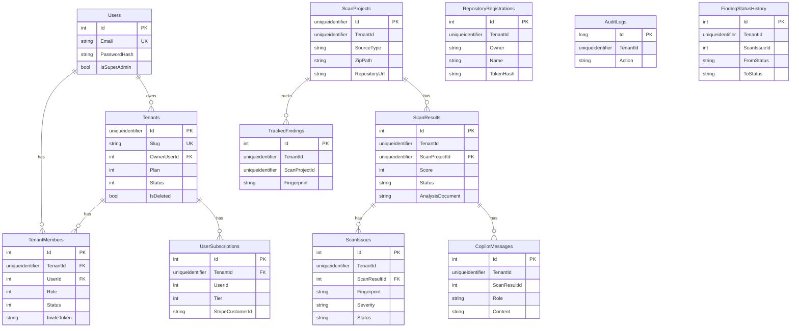

# Database design

The database is a SQL Server database created by EF Core migrations. The development name is `ProdFalconDb`. The model is configured in `ApplicationDbContext.OnModelCreating`. There is no separate SQL project.

Three migrations are checked in:

| Migration | What it changes |
| --- | --- |
| `20260908150026_InitialCreate` | Users, tenants, members, audits, subscriptions, scan projects, scan results, scan issues |
| `20261107060335_SecurityPlatformExpansion` | Finding workflow columns, tracked findings, copilot messages, repository registrations, analysis document, and related indexes |
| `20261107061339_TenantScopedRepositoryRegistration` | Replaces the unique `(Owner, Name)` registration index with unique `(TenantId, Owner, Name)` |

The API runs `Database.MigrateAsync` at startup unless the environment is `Testing`. Tests call `EnsureCreated` on SQLite and do not run these migrations.

## Entity diagram

Scan tables are CLR types in the Application project. Organization tables are CLR types in the Domain project. Both are mapped by the same context.



`FindingStatusHistory` stores `ScanIssueId` and an optional `TrackedFindingId`. The fluent model does not declare an FK from history to issues or from tracked findings to projects. Those relationships are conventional in code, not database constraints. `AuditLog` stores `UserId` without an FK. `ScanProject.UserId` has no FK to `Users`. `UserSubscription.UserId` has no FK to `Users`.

## Keys and relationships that are enforced

| Table | Primary key | Foreign keys | On delete |
| --- | --- | --- | --- |
| `Users` | `Id` identity | None | |
| `Tenants` | `Id` client GUID | `OwnerUserId` to `Users` | Restrict |
| `TenantMembers` | `Id` identity | `TenantId` to `Tenants`, `UserId` to `Users` | Cascade both |
| `UserSubscriptions` | `Id` identity | `TenantId` to `Tenants` | Cascade |
| `ScanProjects` | `Id` client GUID | None | |
| `ScanResults` | `Id` identity | `ScanProjectId` to `ScanProjects` | Cascade |
| `ScanIssues` | `Id` identity | `ScanResultId` to `ScanResults` | Cascade |
| `AuditLogs` | `Id` bigint identity | None | |
| `FindingStatusHistory` | `Id` identity | None declared | |
| `TrackedFindings` | `Id` identity | None declared | |
| `CopilotMessages` | `Id` identity | None declared | |
| `RepositoryRegistrations` | `Id` identity | None declared | |

Deleting a tenant cascades to members and subscriptions. It does not cascade to scan projects, because scan projects do not have a tenant FK. A super-admin delete sets `IsDeleted` and `Status = Deleted`. It does not remove scan rows. The tenant query filter hides the tenant. Scan rows remain, filtered only by their own `TenantId`.

Deleting a scan project cascades to results and then to issues. Tracked findings for that project are not cascade-deleted by the database.

## Constraints and indexes

Unique:

- `Users.Email`
- `Tenants.Slug`
- `TenantMembers (TenantId, UserId)`
- `TrackedFindings (ScanProjectId, Fingerprint)`
- `RepositoryRegistrations (TenantId, Owner, Name)`

Other indexes used by filters and lists:

- Members: `TenantId`, `InviteToken`
- Audits: `TenantId`, `Timestamp`
- Scan projects: `UploadedAt`, `TenantId`
- Scan results: `ScanProjectId`, `CreatedAt`, `Status`, `TenantId`
- Scan issues: `Severity`, `RuleName`, `Fingerprint`, `Status`, `TenantId`
- Finding history: `ScanIssueId`, `TenantId`
- Tracked findings: `TenantId`, `Status`
- Copilot messages: `ScanResultId`, `TenantId`
- Registrations: `TokenHash`, `TenantId`
- Subscriptions: `StripeCustomerId`, `UserId`, `TenantId`

String columns that the API writes have max lengths in the fluent model. Examples: issue `FilePath` 1024, `Evidence` 2000, `Remediation` 4000, registration `TokenHash` 128. `ScanResult.AnalysisDocument` is stored as a string without a max length in the configuration shown, so SQL Server maps it as `nvarchar(max)`. Confirm the snapshot before assuming a smaller column.

`ScanService` truncates a relative path to 1024 characters before save. Other long strings depend on the rule author staying inside the configured maximum. A value that exceeds the column length fails the save.

## Tenant isolation

`ApplicationDbContext.CurrentTenantId` returns `ITenantProvider.TenantId`. Query filters compare `TenantId` to that value for members, audits, projects, results, issues, finding history, tracked findings, copilot messages, registrations, and subscriptions.

`Tenant` itself is filtered with `!IsDeleted` only. It is not filtered by the current tenant. Super-admin listing uses `IgnoreQueryFilters` so deleted tenants can be included or excluded by the service, not by the global filter.

`SaveChanges` sets `TenantId` on added `ITenantEntity` rows when the current tenant is non-empty and the entity's tenant id is still empty. Webhook and CI flows set the tenant id on the entity explicitly because they also call `SetTenant`.

A query with `TenantId == Guid.Empty` matches nothing under the filter. That is why the worker must set the tenant before it loads the queued scan.

## Column notes that affect behavior

- `Tenants.StorageLimit` defaults to 1,073,741,824 (1 GB) in the entity initializer. `ScanLimit` defaults to 5. Super-admin plan updates overwrite both. Nothing in the scan path reads `ScanLimit` before accepting work.
- `Tenants.Plan` and subscription `Tier` are stored as ints. The enum is `Free = 0`, `Pro = 1`, `Enterprise = 2`.
- `ScanProjects.Status` is a string, not a check constraint. Observed values include `Queued`, `Scanning`, `Completed`, `Failed`, and `Cancelled`.
- `RepositoryRegistrations.TokenHash` is a hex SHA-256 of the CI bearer token. `TokenPrefix` stores the first eight hex characters of the token for display. The raw token is returned once by the register action and is not a column.
- `UserSubscriptions.StripeCustomerId` and `StripeSubscriptionId` exist. The Stripe service does not write live Stripe ids.

## Query and performance considerations

History and finding queries are paged with `Skip` and `Take` after `Count`. Page size is clamped to 100. Filters on severity, status, and category can use the indexes on those columns. The search filter uses `Contains` on title, path, rule name, and category, which is a scan within the tenant's filtered set.

`GetSummaryAsync` and project dashboard loading include issues and then aggregate in process. They are not SQL `GROUP BY` queries. Cost grows with the tenant's history.

Compare loads both scans with issues. It matches on fingerprint in memory.

Global filters add a predicate to generated SQL. They do not replace indexes. `TenantId` is indexed on the large tables, which is the right leading column for those filters. Composite indexes for `(TenantId, CreatedAt)` or `(TenantId, Status)` are not defined. They would matter only after a tenant's history is large enough to show up in a plan.

## How to change the schema

1. Change the CLR type and, if a constraint or index is involved, `OnModelCreating`.
2. Add a migration from a machine that can see the SQL Server connection the factory uses:

```bash
dotnet ef migrations add <Name> --project ProdFalcon.Infrastructure --startup-project ProdFalcon.API
```

3. Read the generated `Up` method before applying it. Destructive drops should be intentional.
4. Apply locally:

```bash
dotnet ef database update --project ProdFalcon.Infrastructure --startup-project ProdFalcon.API
```

5. Run `dotnet test`. Remember that tests use `EnsureCreated` and will not execute the migration SQL.

Do not edit a migration that has already been applied to a shared database. Add a new one. Startup `MigrateAsync` applies every pending migration with the application's rights, so the application login needs DDL permission or migrations must be applied by a separate account before the app starts. The current host always migrates itself outside `Testing`. That is convenient for a single developer and noisy in a locked-down production database. A production pipeline can apply migrations as a step and then set the environment so operators know startup will also try. There is no feature flag to disable startup migration.

Rollback is `dotnet ef database update <PreviousMigration>`. Take a backup first. Down methods exist for the checked-in migrations. They are not a substitute for a restore when data has been written.

## Related documents

- [DEPLOYMENT.md](DEPLOYMENT.md)
- [adr/0002-database-and-orm.md](adr/0002-database-and-orm.md)
