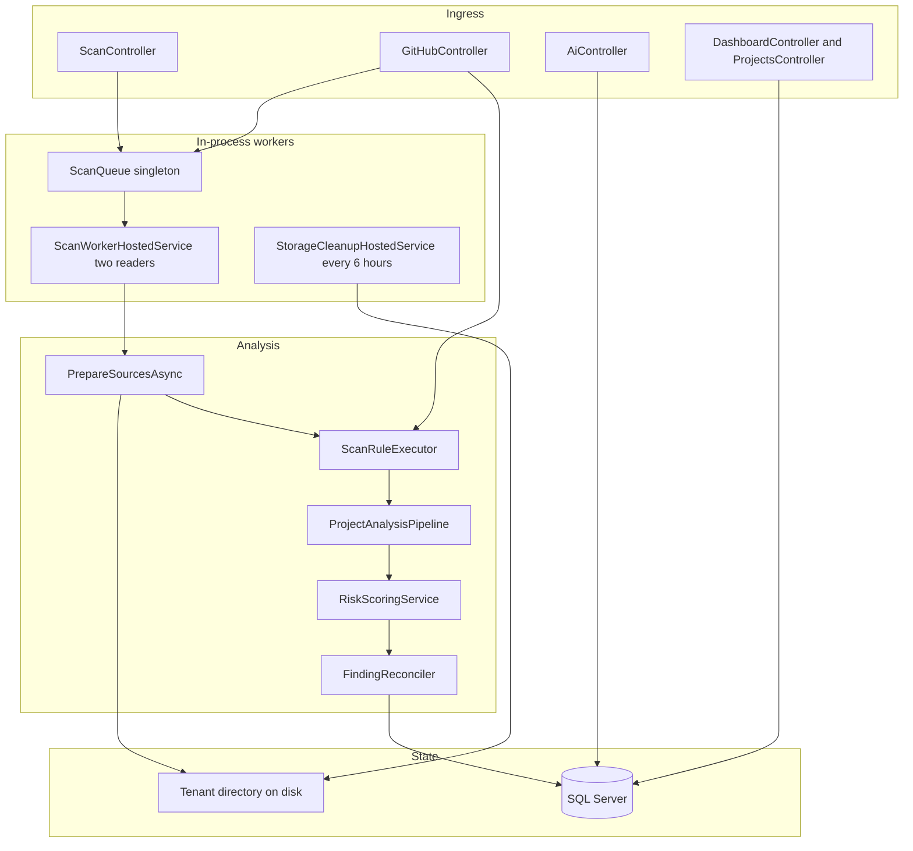

# System design

This document describes the runtime components that turn an uploaded archive or a GitHub repository into a stored scan, and what happens when that work fails.

## Components

| Component | Implementation | Responsibility |
| --- | --- | --- |
| Scan API | `ScanController` | Authorize the caller, persist a queued project, enqueue work, read results |
| GitHub API | `GitHubController` | Repository registration, webhook, synchronous CI scan, workflow file |
| Queue | `ScanQueue` | In-memory channel of `ScanWorkItem` |
| Worker | `ScanWorkerHostedService` | Two loops, each creating a DI scope and a linked cancellation token |
| Scan use case | `ScanService` | Acquire source, run rules, analyze, score, reconcile, save |
| Storage | `ProjectStorageService` | `StorageRoot/{tenantId:N}/{projectId:N}/upload.zip` and `extracted/` |
| Query | `ScanQueryService` | History, findings, compare, status changes |
| Reports | `ScanReportWriter` | JSON, CSV, and PDF bytes from a `ScanResultDto` |
| Cleanup | `StorageCleanupHostedService` | Deletes project directories older than two days |
| Suggestions | `OpenAiSuggestionService` | OpenAI chat completions or a local fallback |
| Billing | `StripeSubscriptionService` | Returns the tenant plan. Checkout and webhook are stubs |
| Dashboard | `DashboardService` | Aggregates the current tenant's scans in memory after loading them |

`IGitHubIntegrationService` is registered. The controller uses the workspace store, storage, and scan service directly for the paths that are implemented.

## Archive pipeline

1. The client sends `multipart/form-data` with a file field to `POST /api/scan/upload`. The request size limit attribute is 104,857,600 bytes, matching the default `Scanning:MaxUploadBytes`.
2. Viewers receive 403. Other authenticated roles continue.
3. The extension must be `.zip`. The service writes `upload.zip` under the tenant directory.
4. `SafeZipExtractor.Validate` opens the archive, rejects an empty archive, rejects more than `MaxEntries` entries (8,000), rejects declared uncompressed size above `MaxExtractedBytes` (500 MB), and rejects a compression ratio above `MaxCompressionRatio` (100) when the relevant size exceeds 1 MB. Entry names that are rooted or contain `..` are rejected. The resolved path must stay under the destination prefix.
5. A `ScanProject` with `SourceType = Zip` and a `ScanResult` with `Status = Queued` are saved. Configuration JSON defaults to `{ "fullAudit": true }` when the form field is omitted.
6. A `ScanWorkItem` is enqueued. The HTTP call returns the new ids. Extraction has not happened yet.
7. A worker sets the tenant, then `PrepareSourcesAsync` calls `ExtractZipAsync`. Extraction writes files in 80 KB chunks and stops if the bytes actually written exceed `MaxExtractedBytes`. The declared-size check and the written-byte check are both required because a ZIP header can lie.
8. `ProjectTechnologyDetector` records languages and frameworks. `SourceTree` enumerates files, skipping dependency and build directories (`node_modules`, `bin`, `obj`, `.git`, and others) and binary-like extensions. Enumeration stops at 4,000 files. Individual files larger than `MaxFileBytes` (1 MB) are not read as text.
9. `ScanRuleExecutor` runs registered rules. Module flags on `ScanModuleSelection` can skip a module when `fullAudit` is false. With `fullAudit` true, every module runs.
10. `ProjectAnalysisPipeline` builds a profile, an architecture graph, and a threat model. IO failures become an `UnverifiedAreas` note rather than a failed scan.
11. Issues are de-duplicated by fingerprint (`rule`, path, line, title). Paths stored on the issue are relative to the extract root when possible.
12. `FindingReconciler` compares the new issues with tracked findings and the previous completed scan.
13. `RiskScoringService` scores open findings only. Critical deducts 25, High 15, Medium 8, Low 3, Informational 0, scaled by confidence. The methodology string is also returned by `GET /api/scan/scoring`.
14. The scan row, issues, analysis JSON, and tracked findings are saved. Project status becomes `Completed`.

GitHub scans skip the client upload. The worker calls `GitHubRepositoryClient`, which reads repository metadata, downloads a zipball, and then uses the same extract and analyze steps. A token supplied on the request is held on the queue item. It is not a column on `ScanProject`.

The CI endpoint (`POST /api/github/ci`) performs steps 4 through 14 inside the HTTP request after authenticating a repository token hash. It then runs `GitHubPolicyEvaluator` and returns 422 when the policy fails.

## What the scanners cover

Registered `IScanRule` implementations:

- Hardcoded connection strings, JWT secrets, API keys, and plaintext passwords
- SQL concatenation risk
- Missing authorization, debug mode, Swagger left enabled, CORS wildcards, raw HTTP usage
- Sensitive logging and missing logging
- Configuration security and code quality
- `ExtendedStaticAnalysisRule`
- `DependencyVulnerabilityRule`, which queries OSV and is registered from Infrastructure because it uses `HttpClient`

`SecretsAnalyzer` and `SqlInjectionAnalyzer` support the rules. `SecretRedactor` stores a description and a length, not the secret value, and treats common placeholders as non-findings.

`CodeQualityAnalyzer` and `PerformanceReliabilityAnalyzer` add findings outside the original security set. Categories used by the findings filter to mean "quality" are `Maintainability`, `Architecture`, `Reliability`, `Quality`, and `Performance`, plus rule ids that start with `QUAL-`, `REL-`, or `PERF-`.

Project intelligence is heuristic source inspection. Tests assert that the architecture graph does not invent a call that is not present in the sample, and that the profile separates a detected stack from an inferred purpose. Treat both outputs as analysis artifacts, not as a complete model of the uploaded system.

## Storage

Default root resolution:

1. `Storage:RootPath` when it is non-empty.
2. Otherwise a path four levels above `AppContext.BaseDirectory`, combined with `ProdFalcon_Storage`.

From `dotnet run` on the API project, that lands next to the solution. Directories are created at service construction. Paths include the tenant id, so one tenant's files are not stored in another tenant's folder. `TenantIsolationTests` covers the upload path.

Cleanup runs every six hours and deletes a project directory whose last write is at least two days old and whose folder name parses as a GUID. It does not delete database rows. A scan can therefore outlive its extracted source. Later code that expects `ExtractedPath` to exist must handle a missing directory. `PrepareSourcesAsync` re-extracts when the ZIP is still present.

`ProjectStorage/ExtractedProjects/` in the git repository is older output. The current service does not write there unless `Storage:RootPath` is pointed at it.

## API interaction

Interactive clients poll `GET /api/scan/{id}` or `GET /api/scan/history` because the upload call returns before analysis finishes. Stage values written during a run include `Queued`, `Extracting archive`, `Acquiring repository`, `Detecting technologies`, `Running scanners`, `Understanding project`, `Scoring`, `Completed`, `Failed`, and `Cancelled`.

`POST /api/scan/{id}/cancel` removes a queued token signal and sets the row to `Cancelled`. If the worker has already passed the cancellation check, the linked token aborts the run and `ScanService` records the cancellation again.

Reports call `IScanQueryService.GetScanAsync` and then `ScanReportWriter`. The PDF writer is a small generator in that class, not a third-party reporting engine.

AI endpoints load the stored scan. They do not re-read the extracted tree. Conversation history is `CopilotMessage` rows returned by `GET /api/scan/{id}/conversation`.

## Failure scenarios

| Failure | What the caller sees | What is persisted |
| --- | --- | --- |
| Empty or invalid ZIP | 400 from the upload or CI call | Project directory is deleted for the rejected upload |
| Unsafe ZIP path or size | `InvalidDataException` mapped to 400 on the upload path | Cleanup of that project id |
| GitHub repository missing, private without a token, or oversize archive | The worker fails the scan. The original HTTP call already returned 200 queued | `Failed` plus `ErrorMessage` |
| Scanner exception | Worker log. Client sees `Failed` on the next read | `Failed` |
| Timeout or cancel | Worker log | `Cancelled` |
| Analysis IO exception | Scan still completes | `UnverifiedAreas` on the analysis document |
| OpenAI HTTP failure | 200 with heuristic suggestions | Copilot fallback text. The warning is logged |
| SQL unavailable at startup | Process does not listen | No partial migration handling in `Program.cs` |
| Process restart while queued | The client keeps a scan id stuck at `Queued` | The in-memory queue is gone. No recovery loop re-queues `Queued` rows |
| Disk full during extract | Scan fails | Partial directory may remain until cleanup or an explicit delete |

`MarkTerminalAsync` swallows exceptions from the status write. The original exception is still logged by the worker. If the status write fails, the row can remain `Queued` or `Scanning`.

## Scalability

The design assumes one API process.

- Two workers cap parallelism at two scans. A third archive waits in memory.
- Each GitHub download buffers the ZIP in a `MemoryStream` up to `MaxUploadBytes` before it is written to disk. A 100 MB archive costs 100 MB of managed memory on that worker, then disk space for the ZIP and the extracted tree.
- `DashboardService.GetSummaryAsync` loads the tenant's scan results and issues into memory. That is acceptable for a small tenant and expensive for a tenant with a large history. History and findings endpoints are paged. The summary endpoint is not.
- OSV calls are capped per scan by `MaxDependencyQueries` (30). They still add external latency inside the scan timeout.
- There is no back-pressure beyond the rate limiter on two POST routes and the unbounded in-memory channel. A client that stays under 10 requests per minute can still enqueue more work than two workers finish before a restart.
- Tenant filters are applied in SQL. They do not, by themselves, prevent a hot tenant from filling the disk under `StorageRoot`.

Improvements that are not implemented: a durable queue with a lease, a claim query so multiple hosts can run workers, streaming GitHub downloads to disk, paged dashboard aggregation, and a hard quota check before enqueue.

## Related documents

- [ARCHITECTURE.md](ARCHITECTURE.md)
- [SECURITY.md](SECURITY.md) for archive abuse cases
- [adr/0004-file-storage-and-processing.md](adr/0004-file-storage-and-processing.md)
